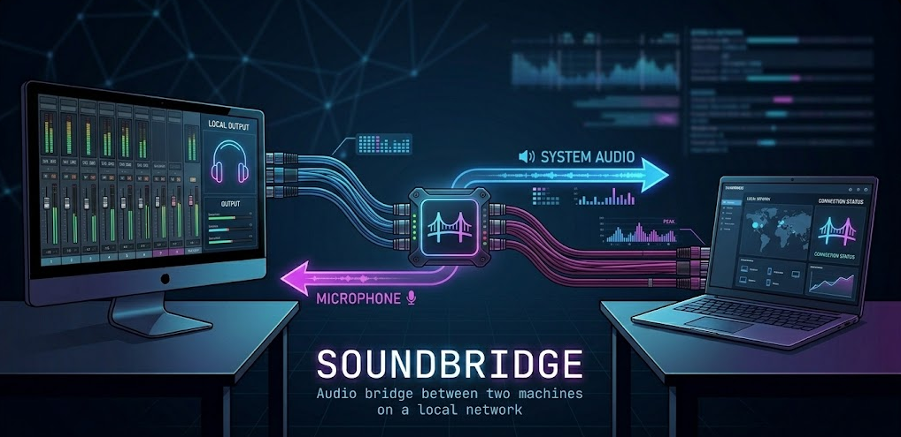

Audio bridge between machines on the same LAN via UDP. A Linux or Windows server captures system audio; a Windows, macOS or Linux client plays it on headphones. Clients discover the server automatically through mDNS, without an IP address. Optional microphone return creates a virtual input on Linux servers for apps like Discord and Google Meet. See the [macOS guide](docs/MAC.md) and [Windows guide](docs/WINDOWS.md) for platform setup.

## Features

- **Opus codec** — compresses ~1920 bytes PCM to ~160 bytes Opus per frame, zero IP fragmentation
- **FEC + PLC** — Forward Error Correction and Packet Loss Concealment via libopus, smooth audio instead of clicks when packets are lost
- **Adaptive jitter buffer** — RFC 3550, automatically adjusts buffer depth based on network jitter
- **Sequence numbers** — gap detection to trigger PLC on lost frames
- **Virtual mic via pipe-source** — FIFO direct to PipeWire, minimal latency (~42ms buffer), Discord/Meet see it as a real microphone
- **Zero config** — automatic discovery via mDNS (zeroconf), no manual IPs
- **Heartbeat** — disconnect detection in 5s, automatic reconnection

## Architecture

```
Linux (Server)                              Windows (Client)
──────────────────────────────────────────────────────────────
System Audio (parec)                        Headphone Playback
        │ Opus encode                          ▲ Opus decode
        └──── UDP :4410 (stereo, 48kHz) ───────┘

Virtual Mic (pipe-source FIFO)              Mic Capture
        ▲ Opus decode                          │ Opus encode
        └──── UDP :4411 (mono, 48kHz) ─────────┘

mDNS (zeroconf)  ◄──── service discovery ──►  mDNS (zeroconf)
Heartbeat        ◄──── UDP :4413 ──────────►  Heartbeat
```

### Protocol

UDP packets with a 10-byte binary header:

```
| magic "SB" (2B) | type (1B) | channels (1B) | sample_rate (2B) | seq (2B) | payload_size (2B) | Opus data |
```

Packet types:
- `0x01` — system audio (stereo, Opus 128kbps)
- `0x02` — microphone audio (mono, Opus 64kbps)
- `0x03` — heartbeat (normally no payload; legacy discovery requests carry a marker)
- `0x04` / `0x05` — discovery request/response with a 16-byte nonce (no audio commitment)

### Connection flow

1. Server registers mDNS service `_soundbridge._udp.local.` and listens for heartbeats on port 4413
2. Client discovers a primary IPv4 A record and additional interfaces in mDNS TXT records (zeroconf ServiceBrowser); the primary A record preserves older clients
3. Client probes those addresses without starting streams on unselected servers
4. After a reachability response, client pins the effective source endpoint, starts playback and sends heartbeats; only that server starts streaming
5. If heartbeat fails (5s without response), disconnects and restarts discovery

Interface changes refresh mDNS registration and browsing while searching. Direct
DNS retries run independently of packet I/O; cancelling a search discards its
pending replies and late DNS results before another search can use them.

Older clients still connect by heartbeat. New clients fall back to sequential
heartbeat attempts for older servers that do not support discovery probes. Only
the selected server's audio is accepted; unreachable legacy addresses can make
discovery slower. The first explicit `--ip` connection also validates the effective
source endpoint before playback. Modern nonce replies can validate a secondary
address with a different source; legacy heartbeat replies must come from the exact
address being attempted. An older server therefore needs its actual sending address.

## Requirements

- Python 3.12+
- [uv](https://docs.astral.sh/uv/) (package manager)
- **Linux**: `libopus0` and PipeWire (or PulseAudio)
- **Windows**: `opus.dll` (already bundled in the project)
- **macOS client**: Homebrew `opus` (see [installation](docs/MAC.md#install))

```bash
# Linux — install libopus (probably already installed via PipeWire)
sudo apt install libopus0
```

## Installation

```bash
git clone https://github.com/AndersonFirmino/SoundBridge.git
cd SoundBridge
uv sync
```

## Network setup

Automatic discovery is the default for Linux/Windows servers and Windows/macOS/Linux clients on the same multicast-capable LAN. It uses mDNS on UDP 5353 (`224.0.0.251`); allow this on both hosts as well as UDP 4413 heartbeats. Clients receive audio on UDP 4410; optional microphone return to a Linux server uses UDP 4411. Scope firewall rules to trusted networks and the actual Python executable (including `pythonw.exe` for a hidden Windows server). Guest Wi-Fi, client isolation, multicast filtering or different VLANs can prevent discovery. See [platform permissions](docs/WINDOWS.md#automatic-lan-discovery).

Modern reachability probes go to server UDP 4413; replies return to the client's
ephemeral request port. Restricted firewalls must permit stateful UDP return
traffic for these requests. Do not open every ephemeral port indiscriminately.

### Windows Firewall

```powershell
# PowerShell as administrator — allow ports
netsh advfirewall firewall add rule name="SoundBridge UDP In" dir=in action=allow protocol=UDP localport=4410,4411,4413,5353 profile=private
netsh advfirewall firewall add rule name="SoundBridge UDP Out" dir=out action=allow protocol=UDP remoteport=4410,4411,4413,5353 profile=private
```

### Linux Firewall

```bash
# Apply only on your trusted LAN interface; replace <LAN_INTERFACE>.
sudo iptables -I INPUT -i <LAN_INTERFACE> -m conntrack --ctstate ESTABLISHED,RELATED -j ACCEPT
sudo iptables -I INPUT -i <LAN_INTERFACE> -p udp -m multiport --dports 4410,4411,4413,5353 -j ACCEPT

# Make persistent (Debian/Ubuntu)
sudo apt install iptables-persistent
sudo netfilter-persistent save
```

## Usage

### Server (Linux or Windows)

```bash
# With GUI
uv run soundbridge server

# Without GUI
uv run soundbridge server --no-gui

# List audio devices
uv run soundbridge server --list-devices
```

### Client (Windows, macOS or Linux)

```powershell
# With GUI — double click soundbridge-client.bat
# Or via terminal:
uv run soundbridge client

# Without GUI
uv run soundbridge client --no-gui

```

On macOS, run `./scripts/mac/run-client.sh` for CLI playback without mic capture.
This works with Windows and Linux servers; see [the macOS guide](docs/MAC.md).

### Tailscale / VPN (no mDNS)

Tailscale and many routed VPNs do not carry mDNS. Only when multicast discovery
is unavailable, pass the server's reachable IPv4 address:

```bash
uv run soundbridge client --no-gui --ip <SERVER_VPN_IP>
# macOS playback only:
./scripts/mac/run-client.sh <SERVER_VPN_IP>
```

The hosts must have routes and UDP audio/heartbeat permissions in both directions.
After a timeout, a client started with `--ip` also retries that address, so recovery
does not require mDNS.

## Tests

```bash
uv run pytest -v tests/
```

```
tests/
├── conftest.py         # fixtures: PCM frames and byte payloads
├── test_opus.py        # roundtrip encode/decode, PLC, compression ratio
├── test_protocol.py    # 10-byte header, seq number, encode/decode
├── test_audio.py       # jitter buffer, prebuffering, devices, parec/pacat
├── test_network.py     # UDPSender, Discovery (zeroconf), heartbeat
└── test_state.py       # ConnectionState enum
```

## Project structure

```
soundbridge/
├── pyproject.toml          # dependencies and build config (uv + hatchling)
├── soundbridge/
│   ├── main.py             # Server, Client, CLI
│   ├── opus.py             # ctypes wrapper for libopus (encoder/decoder/PLC)
│   ├── audio.py            # Capture, Playback (jitter buffer), VirtualMicSource (pipe-source)
│   ├── network.py          # UDPSender, UDPReceiver, Discovery (zeroconf), Heartbeat
│   ├── protocol.py         # binary protocol encode/decode (10B header + seq)
│   ├── config.py           # constants (ports, sample rate, packet types)
│   ├── state.py            # ConnectionState enum
│   ├── gui.py              # CustomTkinter + system tray
│   └── opus.dll            # libopus 1.5.2 win-x64 (bundled)
└── tests/
```

## Configuration

| Constant | Value | Description |
|---|---|---|
| `SAMPLE_RATE` | 48000 | Hz |
| `FRAME_SIZE` | 480 | Samples per frame (10ms) |
| `CHANNELS_STEREO` | 2 | System audio |
| `CHANNELS_MONO` | 1 | Microphone |
| `AUDIO_PORT` | 4410 | UDP — system audio |
| `MIC_PORT` | 4411 | UDP — microphone |
| `HEARTBEAT_PORT` | 4413 | UDP — heartbeat |
| `HEARTBEAT_TIMEOUT` | 5.0s | Time without heartbeat = disconnect |

## Branches

- `main` — stable release
- `develop` — staging for next release
- `feature/*` — feature branches merged into develop

## License

MIT
